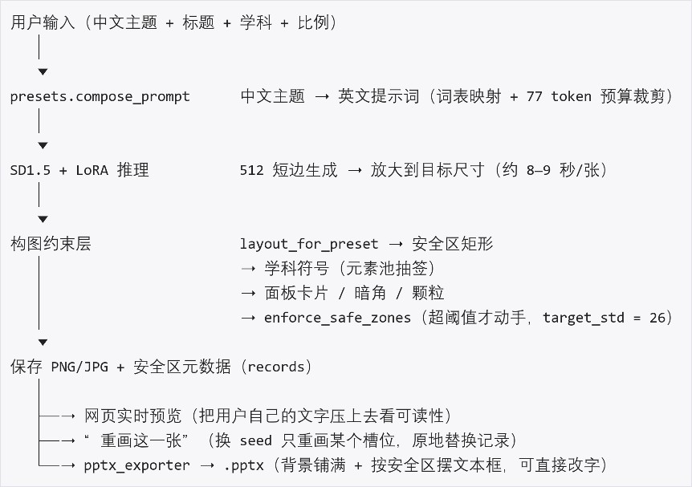

# 一句话生成会留白的 PPT 背景 · 技术报告（第三版）

> 本报告对应仓库当前状态：数据集 data/dataset_v4（生成器 1.5.0），发布权重 train/runs/pptbg-lora-v5-nobokeh/checkpoint-1000，网页应用 app/。文中出现的数字都可以按第 11 节的命令重跑一遍，评测的原始数据放在 eval/results_v1/。 第三版比上一版多了三部分内容：六个可调项（配色、柔焦、磨砂强度、磨砂形状、元素密度、符号质感），元素池的第二次扩容（高数 9 件、机械 8 件、哲学 9 件），以及模型笔触从试错到定位的完整记录。

## 摘要
做幻灯片背景，难的地方并不在画面好不好看。通用文生图模型的训练目标是细节丰富、对比强烈，而背景图需要的是大面积低对比、留出结构化的空白，两者的优化方向正好相反。提示词写得再细，也传达不了“这一块要放字”这样的空间信息，因为模型既没有这条输入，也没有为它准备过训练信号。

我们的做法是把这条隐含要求写成显式的量。先定义安全区，也就是画面上适合压字的那块矩形区域；再用局部亮度标准差 safe_zone_std 度量它干净到什么程度，让它成为可测量、可训练、也可以事后复核的指标。然后拿 LoRA 在自建的 600 张合成背景上把这一偏好教给 SD 1.5，推理阶段再用一层约束把不达标的地方压回去。

第二版的改动集中在三个方面。一是学科化，分类从原来的行业场景改成高等数学、机械制图、人生哲学与科学方法论，每个学科配一套挂在固定基准上的符号系统。二是整套生成，一次请求直接产出 8 页 PPT。三是权重换代，从 v1 换到 v5。

第三版把可调性做成了产品的一部分。六个可调项让同一学科也能出观感差别明显的背景：每科 5 套配色，柔焦和磨砂各两档模糊，磨砂形状可选方形或椭圆，元素密度分三档，符号质感可选矢量或模型笔触。学科元素池从每科 5 件扩到 9 / 8 / 9 件，同一个 seed 下连着出十张，也不会再是一模一样的画面。

效果可以复核：同一需求、同一 seed、同一条代码流水线，只差加载不加载适配器，安全区对比度是 6.43 对 16.05（越低越干净），版式合规率是 100% 对 75%。工程上用 http.server 加纯 Python 实现，没有引入 Gradio 或 Streamlit，依赖关系简单到可以从零复现。

## 与官方大纲的对应关系
《AIC·AI+开源技术报告参考大纲》（手册附件 2）一共列了九项。本文没有逐项机械套用，但每一项都找得到落点，方便评委对照。

| 官方大纲 | 本文位置 |
|---|---|
| 一、作品概述（背景与问题 / 目标、参赛方向与作品形态 / 核心亮点） | 摘要、第 1 节 |
| 二、需求分析与总体方案（需求分析 / 总体方案 / 可行性与成本） | 1.1–1.2、第 2 节（2.3 即可行性与成本）、8.1、第 10 节 |
| 三、AI 技术与开源及第三方资源选择（AI 的作用 / 开源与第三方资源） | 第 3 节（自建配对标注数据）、第 4 节（LoRA 训练）、第 9 节（资源与许可） |
| 四、项目实施（实施方案 / 关键技术实现） | 第 2、5、7、8、11 节 |
| 五、应用成效（成果展示 / 效益分析） | 第 6 节（可核验指标）、8.4（端到端验收）、8.6（效益分析） |
| 六、开放成果与维护计划 | 第 9 节（开放成果）、13.2（维护计划） |
| 七、合规、安全与风险说明 | 第 9 节、第 10 节、第 12 节 |
| 八、总结与展望（项目总结 / 后续计划） | 第 13 节 |
| 九、附录（开源清单、仓库链接、测试记录、参考文献） | 第 9、11 节、附录 A，以及随报告提交的《开源及第三方资源使用清单》 |

## 1. 问题与场景价值

### 1.1 场景

做幻灯片时，背景图这一环反复出现三个问题。

1.找图费时间。图库里翻十几分钟，最后往往随手拿一张，跟汇报内容没什么关系。

2.图上压字读不清。图本身很好看，但标题偏偏落在高对比的区域，字要么糊在纹理里，要么另加一块色块垫着，很碍眼。

3.风格不统一。一页一个来源，整份 PPT 看下来像拼贴画。

### 1.2 通用文生图模型为什么解决不了第 2 条

通用文生图的训练目标是产出细节丰富、对比强烈的画面，而 PPT 背景要的是大面积低对比、留出结构化的空白，两个目标互相冲突。这一点靠改提示词解决不了：模型手里没有“这块要放字”的信息，训练过程中也没有任何信号让它往这个方向走。

我们把这件事拆成三步。先把安全区定义为适合压字的矩形区域，用局部亮度标准差 safe_zone_std 度量它干净到什么程度；再让模型在训练中朝这个方向偏；最后在推理之后用一层约束，把仍然不达标的地方压下去。指标、训练、约束三件事彼此独立，出了问题可以分开查。

### 1.3 改成学科分类的缘由

第一版按行业场景分类，分了学术汇报、商业计划、公益项目等八类。实际出图时，八类画出来是同一张抽象色场，因为它们之间的差别只在色调，形体上没有区别。指导老师的意见很直接：应该按学科分，而且每个背景都要突出学科特色，不能只是纯色。

按学科分的好处是每个学科都有公认的图形语言。高数用坐标纸和函数曲线，机械制图用图框、标题栏和尺寸标注，人生哲学是一张纸、几点墨和大量留白。这些形体彼此可区分，扫一眼就知道是哪一科，行业场景恰恰给不了这种辨识度。代价也很清楚：这些形体必须由确定性代码画出来，指望 512 分辨率的 LoRA 学会并不现实。第 6 节用三组对照实验证明了这一点。

## 2. 系统结构

### 2.1 分层

### 2.2 一次生成整套 PPT

POST /api/deck 把生成背景和排版合并成一步，前端只需要发一次请求。

| 步骤 | 做什么 | 为什么 |
|---|---|---|
| 1 | 只画 3 张底图（cover / content / end 三种取向） | 一整套 PPT 要保证视觉一致，底图就得少而统一；限功率状态下单张要 9–45 秒，画 8 张不可接受 |
| 2 | plan_slides(topic, 8) 规划 8 页骨架 | 页序按封面、目录、第 1–5 部分、谢谢排定，用户不用自己拆页 |
| 3 | 背景按页序循环复用，逐页按该页的安全区摆文本框 | 页数可以多于底图数，靠 records[idx % len(records)] 实现 |

实测 3 张底图加 8 页排版约 50 秒，产物 200–290 KB。正文文字是故意留的占位骨架（比如“第 1 部分”“内容页占位：在此填入要点”），因为让模型生成看似详实、实际编造的正文，对参赛作品来说是减分项。

### 2.3 可行性与成本

| 项 | 实测 |
|---|---|
| 算力 | 单卡 RTX 5070 Laptop 8G；训练 1000 步 22 分钟，推理 28 步 8.5 秒一张（512 出图，再上采样到 1920×1080） |
| 存储 | 基座 3.1 GB + 数据集 330 MB + 适配器 12.5 MB；开源仓库本体 10 MB（不含权重） |
| 数据 | 零采购、零抓取：600 张全部由脚本在本机渲染产出，安全区标注与图像同一次渲染 |
| 时间 | 从零到可演示约 13 天，单人加 AI 编程工具；训练与评测各占 22 分钟与 25 分钟 |
| 依赖 | Python 3.10–3.12 + torch(CUDA)。无显卡或未放权重时自动降级到程序化后端，整条链路照样跑通 |

结论：在赛题“不训练大模型、不购买专用硬件、不做企业级系统”的约束内完成。全部成本是一台带 8G 显卡的笔记本，和大约两小时的 GPU 时间。

## 3. 数据集

### 3.1 为什么用合成数据

用合成数据是权衡之后的选择，理由按重要性排列。

•合规：整个流程不涉及任何第三方图片素材的复制、训练、改编和再分发，授权问题从源头就不存在。

•可标注：安全区在渲染时就是已知的构造参数，不需要人工标注，也就不存在标注噪声。

•可平衡：6 个预设各 100 张，版式分布可以控制，避免真实素材的长尾偏置。

•可复现：全部由 seed 驱动，同一个 seed 配同一版代码，产出的图逐字节一致。

代价也要写清楚。合成母图的视觉复杂度低于真实照片，模型学到的只是这一分布上的先验，至于它对真实摄影素材能泛化到什么程度，我们没有验证，见第 10 节。

### 3.2 生成链

1.data/make_placeholder_assets.py 程序化生成母图，8 个家族（gradient_blobs、geometric、paper、stripes、wave、bokeh、fbm_cloud、fbm_silk），每类 36 张，data/assets_v2 共 288 张。

2.make_backgrounds.py（GENERATOR_VERSION = "1.5.0"）合成 1920×1080 的背景，顺序是：采样预设 → 影调 → 版式 → 母图几何变换（旋转、镜像、随机窗口裁切、透视 QUAD、径向漩涡、偏心光晕、色调分离）→ 影调映射 → 双色调 → 径向光 → 叠色 → 纹理 → 面板/暗角/颗粒 → 写入安全区 safe_zones → 生成英文 caption。

3.validate_dataset.py 做六项体检，prepare_dataset.py 按 image_sha256 做稳定切分。

### 3.3 体检口径

| 编号 | 查什么 | 阈值 |
|---|---|---|
| C1 | 能否解码、尺寸是否一致 | 必须 |
| C2 | 分布均衡（单类占比、版式分布） | 最大占比 ≤ 0.4 |
| C3 | 安全区局部对比度 | 期望 ≤ 26，告警线 40 |
| C4 | 全局亮度 | 25–236 |
| C5 | 近重复（dHash 8×8，Hamming ≤ 4 且平均色差 ≤ 8） | 重复率 ≤ 5% |
| C6 | 溯源与 caption 自洽 | 必须 |

### 3.4 去重迭代（负结果的完整记录）

| 版本 | 加了什么 | 600 张重复率 |
|---|---|---|
| 1.0.0 | 缩放 + 模糊 + 染色 | 19.7%（118 对） |
| 1.1.0 | + 旋转 / 镜像 / 随机窗口 / 双色调 | 9.83% |
| 1.2.0 | + 透视形变，母图池扩到 216 | 6.33% |
| 1.3.0 | + 径向漩涡 / 偏心光晕 / 色调分离 | ≤5%（40 张抽样 0） |
| 1.3.1 | 修图像质量（不是多样性） | 4.0%（24 对），硬问题 0 |

这一轮迭代里有件事值得记下来。1.3.0 的 38 对重复中，有 31 对来自 clean_white：那一版把它模糊到 4.8–32 px，再压成近灰的双色调，画面成了一团“牛奶雾”，不同母图看起来完全一样。dHash 判重只是把症状报了出来，真正的原因是图本身已经没有结构。

### 3.5 1.5.0 的三处改动

1.剔除 36 张 bokeh 母图（288 → 252）。bokeh 是 12–26 个圆盘的叠加，模型把它学成了“在纯色场上点几个圆斑”。第 7 节会说明这个假设最后被证伪，但剔除本身仍然是对的，至少少了一次把毛病再教出去的机会。

2.caption 去掉虚焦语义，softly out-of-focus photographic layer 改成 even soft photographic tone。

3.结构族加模糊下限：条纹、波浪、fbm 三族的 photo_blur_px 取 max(x * 2.2, 18)。这里踩过一个坑，家族名不能用 asset_id.rsplit("_", 1)[-1] 来取，placeholder_287_fbm_silk 会得到 silk，下限就静默失效了。

数据集 v4 的体检结果：600 张，硬问题 0，软问题 21，近似重复 1.83%，切分 train 548 / val 21。

## 4. 模型与训练

### 4.1 选 LoRA 而不是全量微调

参赛作品要在消费级显卡上跑得起来。LoRA 只训 1–2 M 参数（全量微调是 860 M），单张 8 GB 显存的卡就够，权重也只有十几 MB，可以随作品一起开源。适配器只挂在注意力投影层，因为要学的是“场景语义到影调与留白版式”这层构图先验，而不是重新学一遍画风。

### 4.2 配置

| 项 | 值 |
|---|---|
| 基座 | Stable Diffusion 1.5（本地目录，离线加载） |
| 分辨率 | 512（出图后再放大到 1920×1080） |
| rank / alpha / dropout | 16 / 16 / 0.05 |
| 目标模块正则 | .*\.attn[12]\.(to_q\|to_k\|to_v\|to_out\.0)$ |
| 步数 / batch / 梯度累积 | 1000 / 1 / 4 |
| 学习率 / 调度 | 1e-4 / cosine，warmup 50 |
| 精度 | fp16 + 梯度检查点 + sdpa |

### 4.3 实测（RTX 5070 Laptop 8G）

可训练参数 3,188,736 / 862,709,700，占 0.370%。首步 17.4 s 属于 CUDA 预热，之后稳定在 1.25–1.42 s/step，1000 步大约 21–23 分钟。

### 4.4 权重的迭代（含两次负结果）

| 版本 | 数据 | val_loss @250/500/750/1000 | 结论 |
|---|---|---|---|
| v1 | dataset_v1（中心裁剪） | 0.1163 / 0.0736 / 0.1373 / 0.1124 | 首发权重 |
| v2 | dataset_v1（随机窗口裁剪） | 0.1159 / 0.0731 / 0.1381 / 0.1116 | 无收益，弃用 |
| v3 | dataset_v2（fBm 母图） | 0.1104 / 0.0740 / 0.1205 / 0.0864 | 出图结构变多，但 warm_terra 更花，弃用 |
| v4 | dataset_v3（7 种版式 + 装饰层） | 0.1104 / 0.0740 / 0.1205 / 0.0864 | 出图与 v1 无法区分，弃用 |
| v5 | dataset_v4（去 bokeh + caption 改口径） | 0.0843 / 0.0558 / 0.0887 / 0.0765 | 当前发布权重 |

v4 给出了这一节最关键的一个判断：版式是合成层的确定性代码画出来的，模型并没有参与。把数据集的版式从 4 种扩到 7 种、把装饰层叠进训练图之后重训，成图和 v1 几乎分不出来。最终观感由后处理决定，模型在 512 分辨率上贡献的主要是色场和色调。这个判断直接决定了第 5 节的方向：想要更多结构，应该去改合成层，而不是继续加训练步数。

## 5. 学科符号系统

### 5.1 三个学科，三套基准

| 学科 | 底色 | 骨架（必画） | 元素池（每张抽 0–2 件） |
|---|---|---|---|
| 高等数学 | 黑板蓝 #183052 | 坐标纸网格 + 坐标系 + 曲线 1–2 条 + 公式符号 1–3 | 等高线、极坐标网格、矩阵括号、阿基米德螺线、函数值表、傅里叶叠加、级数阶梯、差商三角形、区间阴影（9 件） |
| 机械制图 | 蓝晒 #1E487A | 双图框 + 分区刻度 + 标题栏/明细表 + 尺寸链 | 螺纹、粗糙度、节距标尺、键槽剖面、倒角标注、公差带、齿轮轮廓、中心线组（8 件） |
| 人生哲学与科学方法论 | 宣纸 #EEE9DE | 稿纸横线（88%）+ 墨弧 1–2 笔 | 一笔圆相、竖排短句、引文框、点阵、印章框、书脊三线、双圆相、飞白墨点、田字格（9 件） |

设计原则可以概括成一句：随机的是抽到哪些元素、放在哪个空角、画得多大多密；不变的是每根线都挂在同一套基准上。

这条原则是被两次反馈逼出来的。第一版把元素到处撒，老师反馈线条凌乱；后来收得只剩图框和标题栏，又被说过于简单。两次的差别不在元素数量，而在这些线是否共用同一套基准。

### 5.2 符号必须由合成层绘制（三组证据）

1.v4 对照实验。把数据集的版式与装饰层改掉后重训，成图和 v1 分不出来，见 4.4 节。

2.底图退平实验。把模型出图直接拿去叠学科符号时，模型自己在画网格和曲线，和叠加的符号成了两套线，看上去就是乱的。修法是让学科预设对底图做强低通（GaussianBlur(min(w,h)*0.012)），再往预设色拉 55%，让底图退回一张干净的纸面。

3.合成层与模型解耦。机械制图的元素只用到 ImageDraw 的线段、矩形、多边形和椭圆，和模型完全无关，因此可以单独调、单独验证，也可以单独讲清楚。

### 5.3 干净区保护：两个掩码

软掩码 _zone_mask 按安全区做羽化衰减，用在网格、曲线、稿纸线这类可以淡淡透进压字区的元素上。硬掩码 _zone_mask_solid 不做羽化，用在剖面块、公式符号、印章这类边界明确的小图形上，因为它们一旦落进压字区，就是一块看得见的对比度。

这里踩过一个坑。软掩码的羽化半径按 min(w,h)*0.03 算是 32 px 左右，比页脚、图注那类 54–65 px 的窄条还要大，掩码中心降不到 0，装饰线照旧穿了过去。所以窄条只能走硬掩码。

还有一处要注意：图框、标题栏、尺寸线不参与掩码。它们是 2–3 px 的细线，对局部对比度的贡献可以忽略；可一旦被掩码挖掉一角，线就断成几截，上一版底部散着的几截孤立线段就是这么来的。这属于程序缺陷，跟审美无关。

### 5.4 版式

学科预设只用三种版式（vignette_plain、center_band、top_band），也不画磨砂面板卡片。起因是老师的第一条意见：高数的板书会被磨砂色块遮住。学科背景要的是整片可用的纸面，而不是左边一块面板、右边一片文字的双栏构图。

### 5.5 元素池的第二次扩容：为什么全部不带箭头

第一轮元素池每科只有 4–5 件，用户连着生成几张就能看出重复，组合空间只有几十种。第二轮把池子扩到高数 9 件、机械 8 件、哲学 9 件，同时把所有指向空处的箭头都清掉了。清掉的四类都来自用户的实际反馈，不是我们自查出来的。

| 原元素 | 问题 | 改法 |
|---|---|---|
| 高数“向量箭头”，6–11 根 | 方向随机，不指向任何对象，读起来就是乱画的箭头 | 整件删除，换成极坐标网格（同心圆+ 等角度径向刻度） |
| 机械“引出线” | 指向画面空白处 | 只在画了局部放大圈时才出现，起点在圆周上、箭头落在圆周上 |
| 机械“基准符号”“局部放大标记” | 都带箭头且指向空处 | 从池子里撤掉 |
| 机械“粗糙度”的右侧长尾 | 尾部在制图里是写 Ra 值的位置，画面里没有数值就只剩一根箭杆 | 只留“√ + 顶点”，缩到 0.2s 见方 |

保留下来的箭头只有两类：坐标轴末端和尺寸线两端。它们在数学和制图上有明确语义，分别表示方向和量度的边界，删掉反而讲不通。

新增的 12 件都是自洽图形：傅里叶叠加、级数阶梯、差商三角形、区间阴影、倒角标注、公差带、齿轮轮廓、中心线组、书脊三线、双圆相、飞白墨点、田字格。

元素密度分三档，对应 motif_richness 取 0 / 1 / 2 件。组合空间因此是 C(9,2)=36、C(8,2)=28、C(9,2)=36，再叠加位置和尺寸的连续随机，除了同 seed 的情况，肉眼已经看不出重复。

代价是压字区的最差对比度从 5.6 升到 20.5，阈值是 26。元素靠边抽样时会擦到安全区边缘，目前仍在阈值内，但余量从很宽变成了勉强够用。可行的收敛手段是把候选位置从 24 个提到 40 个、要求离安全区外扩 1.5% 以上，或者在抽样命中边缘时换一件；这几项都还没有实施。

### 5.6 符号质感：模型出手感，代码出几何

学科符号都是矢量画的，看着太干净，这是第三版最想解决的问题。把符号整个交给模型去学，5.2 节的三组证据已经说明行不通，于是走了一条中间路线：纹理由模型提供，几何仍然由代码画。具体分四步。

1.取纹理。用发布权重生成 4 张 512×512 的平铺材质（纸、黑板、蓝晒、象牙纸），提示词里明确要求只出材质，即 flat …, no objects, no text。

2.只留高频。取 hi = g - GaussianBlur(g, 18)，再做均衡化。大尺度的亮度差是模型的构图，不是纸纹；不做这一步，贴上去等于把模型画的明暗又糊回画面。实测的高频 std 是 paper 18.86 /chalk 10.22 / blueprint 23.57 / ivory 25.90。

3.按学科绑材质。高数对黑板，机械对蓝晒，哲学对纸。

4.只乘在新画上去的那一层上，公式是 after = before + (after - before) * grain。几何一个像素都不动，改变的只有线条内部的墨色不匀程度。

实现上有三条约束必须满足。第一，纹理按 1:1 平铺，不能放大：早期版本把 512 的 tile 放大 3.75 倍铺满画面，颗粒变成 4 px，2–3 px 宽的制图线被压成断续的，等于把轮廓线画成了虚线。改成按块 1:1 平铺、奇偶块做镜像翻转之后，颗粒尺度和线宽处在同一量级，线就不再被破坏。第二，粒度下界必须大于 0.8：归一化后取 clip(0.82, 1.30)，最多往下压 18%，低于这个值时一条 2 px 的线在某些行上会被压到接近背景，按 1:1 看就是断口。第三，只加不减：纹理可以把某段线画浅，但不能把它画没，这也是墨色不匀和虚线的分界。

还有一次差点误判。把成图放大 2 倍看，制图线像是断成了虚线，连续三轮调参都没修好。最后换成数值判定，沿外框竖线统计每行的峰值亮度，即 a[100:900, 56:76].max(axis=1)，结果如下。

|  | 均值 | 标准差 | 最小峰值 |
|---|---|---|---|
| 纯矢量 | 58.4 | 8.66 | 54.0 |
| 模型笔触 | 58.5 | 10.06 | 54.0 |

两组的峰值最小值完全相同，说明线其实没有断，看到的“虚线”是 2 倍 NEAREST 放大再叠加 JPEG 压缩造成的视觉假象。这件事的教训是：判断画面到底有没有变差，要看可以复算的量，不能凭截图。

质感选项最终暴露为 symbol_style = vector | brush，默认取 vector。它和另外几个可调项的关系见 8.5 节。

## 6. 评测

### 6.1 设计

评测固定 40 条中文需求（eval/prompts_v1.jsonl），覆盖学术、商务、人文、环保、科技、水墨六类场景，统一 seed 基线，让五个后端跑同一条 SDService 流水线，这样后端之间的差别只来自各自那一步。

| 后端 | 是什么 | 在评测里的角色 |
|---|---|---|
| lora | 本作品 | 待评估对象 |
| sd_base | 同一条流水线，不加载 LoRA | 消融：LoRA 到底带来了什么 |
| procedural | 把数据合成算法直接当生成器 | 消融：证明“训了模型”比“套模板”强在哪 |
| procedural_raw | 同一个入口，只是 with_panel=False | 消融：预设、版式和安全区约束各值多少 |
| noise | 随机低对比噪声 | 下界：证明指标本身有区分度 |

### 6.2 结果（40 条 × 5 后端 = 200 张）

| 指标 | 方向 | lora | sd_base | procedural | procedural_raw | noise |
|---|---|---|---|---|---|---|
| safe_zone_std | 越低越好 | 6.428 | 16.047 | 13.131 | 13.945 | 14.717 |
| artifact_hf | 越低越好 | 6.234 | 13.396 | 4.670 | 5.244 | 128.943 |
| relevance | 越高越好 | 0.789 | 0.748 | 0.849 | 0.637 | 0.552 |
| layout_ok | 越高越好 | 1.000 | 0.750 | 0.950 | 0.000 | 0.000 |
| seconds（单张） | 越低越好 | 8.520 | 7.539 | 0.911 | 0.907 | 0.186 |

达标率（std ≤ 26）与版式合规率：lora 100% / 100%，sd_base 77.5% / 75.0%，procedural 92.5% /95.0%，procedural_raw 95.0% / 0%，noise 100% / 0%。

### 6.3 三条可核验的结论

1.LoRA 的贡献可以测出来，而且不属于结构后处理的功劳。lora 和 sd_base 用的是同一份代码、同一个结构层、同一个 seed，唯一的差别是加载不加载适配器，结果是安全区对比度 6.43 对 16.05，差 2.5 倍，版式合规 100% 对 75%。如果起决定作用的是那套合规模板，sd_base 也应该接近 100%，但它在 40 条里有 10 条把安全区对比度推到了 24.8–28.9。

2.只看 safe_zone_std 会被平凡解骗过去。noise 后端的达标率同样是 100%，可它版式合规是 0%，高频伪影 128.9；它之所以干净，是因为画面上什么都没有。所以这个指标必须和 artifact_hf、layout_ok 放在一起读。

3.模型并不是全面胜出。procedural 在 artifact_hf（4.67 对 6.23）、relevance（0.849 对 0.789）和耗时（0.91 s 对 8.52 s，快 9.4 倍）三项上都更好：规则渲染的画面更干净，色调更贴合预设，也没有推理成本。它在多样性上吃亏，同一预设出的图几乎同质；也要靠 GPU 才能跑，而这两点恰好是本作品存在的理由。

### 6.4 指标口径的一次修正

layout_ok 以及它背后的 layout_compliance() 改过两次口径。

| 版本 | 判据 | 实测结果 | 为什么错 |
|---|---|---|---|
| v1 | 左半图 vs 右半图的平均梯度 | 版式完全正确也只有约 1/3 通过 | 面板只占宽度 30–40%，差异被稀释 |
| v2 | 面板矩形 vs 剩余区域的平均梯度 | procedural 只有 0.500 | 量的是母图纹理有多强，与版式无关 |
| v3 | 标题区/正文区的局部对比度 ≤ 26 | procedural 0.917，noise 0 | 直接对应放字的地方够不够干净 |

v2 的反例可以用 14 张样本的梯度读数说明。clean_white 的母图本身就是大面积白底渐变，留白侧 mean_grad 0.411，面板侧 0.588。母图本来就没有纹理，这时“哪边更干净”已经不是有意义的量；面板反倒因为边缘那道刻意做出的淡过渡带，梯度更高，于是版式正确却被判为不合规。纹理强的 warm_terra 上比值是 0.28，很轻松就通过了。一个指标在母图纹理强时通过、纹理弱时失败，量的其实是母图，不是版式。v3 换成绝对判据之后，这层耦合就断开了。

## 7. 圆斑溯源：一次被证伪的假设

用户反馈，成图中央有一块圆形的色斑。这一节按顺序记录我们怎么从猜、到证伪、再到改对地方，最后的结论和最初的判断正好相反。

第一步先确认斑点在不在模型里。用同一个 seed 直接调 _gen_diffusers，绕过整个合成层出图，斑点照样在，说明它不是后处理加上去的。

第二步追问斑点的形状从哪来。训练集里原本有一族 bokeh 母图，由 12–26 个圆盘径向叠加而成，caption 写的是 softly out-of-focus photographic layer。看上去很像模型把这条规则学成了“在纯色场上点几个直径 30–60 px 的圆”。顺着这个推测，我们做了 v5（configs/lora_v5.yaml）：剔除 36 张 bokeh 母图、改写 caption、给结构族加模糊下限、重新生成 600 张、重训 1000 步。

第三步，这个假设被证伪了。同一个 seed 下，v1 和 v5 的原始出图里，圆斑出现的位置完全相同。两版权重不同、训练数据不同，位置却一样，说明它来自基座在这个 seed 下的隐变量结构，不是那 600 张图教出来的。也就是说，“去掉 bokeh 就能消斑”这个判断是错的，v5 并没有把它消掉。

第四步，把基座侧的可能性逐条试完。

| 试过的手段 | 结果 |
|---|---|
| 换调度器（DPM-Solver / DDIM / EulerAncestral / Heun） | 斑点仍在，且落在同一位置 |
| 降低 CFG（7.5 → 4.5 → 3.0） | 位置不变，反差小一些 |
| 初始 latent 高通（减去大尺度模糊后再反标准化） | 斑点仍在原位；σ=3.0 还会在边角引入新的圈状伪影 |

这三样都换不掉它，唯一没变的是它在图像坐标系里的位置。由此可见，它既不是采样过程长出来的，也不来自初始噪声，而是基座 UNet 或 VAE 在特定空间位置上的固有伪影，被 LoRA 产出的均匀色场“显影”了出来。成像之前没有干净的拦法，除非换基座或换分辨率，而这两条都超出了本作品的约束范围。

第五步，只能在能生效的地方修，也就是合成层，一共两处，都在 _compose_diffusers 里。一是 suppress_blotches(strength=0.55)，对全图做带阻，直接减掉 20–90 px 尺度的亮度起伏，压掉斑点的低频体量，同时保留更细的颗粒和更大范围的渐变。二是 despeckle_discs(k_sigma=4.0,sigma_mid=46.0, dilate=16.0)，在中频带取孤立极值，生成掩码，只在掩码范围内减掉那一层。

第二条最初走了弯路：用大模糊去填，斑点确实没了，可掩码范围内连颗粒一起消失，在 1920 尺寸下变成一块过分光滑的圆片，比原来的斑点更显眼。改成只减中频、保留颗粒才对。修完之后，斑点区与干净区的平均亮度落差从 8.6 级降到 2.0 级。

第六步试过“检测到就重抽”，最后放弃了。要重画，前提是能可靠判断这张到底有没有斑点。我们标定了三种指标：中频极值比、22 px 圆盘匹配滤波、去斑掩码占比。已知有斑点的两张得分是 11.50 和 11.00，其余 20 张落在 1.47–19.00 之间，两组完全重叠，而且最高分出现在肉眼干净的 clean_white 图上，原因是大面积亮底会放大微小的起伏。

再往下，连“按分数挑最好的一张”也不成立。同一请求内连出 6 张按分数排序，分数最低的那张（2.37）顶部一大块明显亮斑，是六张里最丑的。原因是这个分数只度量 20–90 px 的中频对比，大而平滑的斑块落在低频，被带阻压掉了。用它做 best-of-N 会系统性地选错。

最后改成人工挑选加按槽位重画：界面保留 1 / 2 / 4 张可选，每张旁边有一个“重画这一张”按钮，换 seed 只重画那一个槽位，并原地替换记录，这样屏幕上看到的图和导出的 pptx 始终是同一份。

既然消斑不靠 v5，为什么最后还是把发布权重换成了它？因为它在另外三处更干净：训练集里不再有虚焦光斑这条 caption，少了一次把毛病教出去的机会；数据换成 7 种版式加装饰层；val_loss 也低一档。代价是 v5 出图明显偏灰，原来 12% 的叠色拉不回预设色，于是色调合成改成按偏离预设色的程度做动态补偿。

## 8. 网页应用与导出

### 8.1 不采用 Gradio / Streamlit

参赛要提交《开源及第三方资源使用清单》，每一个依赖都得交代许可证和自研边界。http.server 是标准库，零依赖；前端用原生 HTML/CSS/JS，没有构建步骤，整份约 560 行。这样哪些是自研的，在代码层面一眼就能看清。

### 8.2 界面

表单分三步：先选这份 PPT 用在什么场合（3 张学科卡），再填内容主题（可以留空），最后填标题，标题会真实压在预览图上。原来那六个行业风格收进了“更多风格”折叠区，兼容保留，但不占主要位置。

预览有三种视图：文字预览（默认）、纯背景、安全区。文字预览里的字号和导出的 .pptx 完全一致，封面标题 40 pt，正文 17 pt。导出时 1 个图像素等于 1/96 英寸，也就是 0.75 pt，所以 pt 换算成图像素是乘 4/3；预览按这个换算摆字，看到的效果就是导出后的效果。

### 8.3 接口

| 方法 | 路径 | 用途 |
|---|---|---|
| GET | / | 表单页 |
| GET | /api/health | 后端类型、是否已挂载 LoRA |
| GET | /api/scenarios | 场景与预设清单 |
| POST | /api/generate | 生成 1–4 张背景 |
| POST | /api/regen | 重画某一槽位 |
| POST | /api/deck | 一次生成整套 8 页 PPT |
| POST | /api/export | 把当前任务的记录打包成 .pptx |
| GET | /files/<job>/<name> | 取图 / 取 pptx |

### 8.4 端到端验收

app/smoke_test.py 里写了七组断言：首页返回 200 且关键元素齐全、健康检查、预设清单、生成 2 张图、图片可下载且 JPEG 头尾合法、导出的 pptx 能通过 zip 校验且幻灯片数正确，再加上四条负路径（未知预设 400、不存在的任务 404、未知路由 404、路径穿越 400）。目前 7/7 全部通过。

### 8.5 六个可调项

同一学科要能出观感差别明显的背景，靠的是六个彼此独立的可调项。它们都直接摆在页面上，也全部写进生成记录，因此每一张图都能复现。

| 可调项 | 取值 | 实现位置 | 代价 |
|---|---|---|---|
| 学科配色 | 每科 5 套 + 随机 | data/presets.py 的 TINT_VARIANTS | 零成本（只换 tint/ink/accent 三色） |
| 柔焦强度 | 0–1，四档 | apply_soft_focus（6–14 格低频场） | 约 40 ms |
| 磨砂强度 | 0–1，四档 | apply_frost_patches | 约 60 ms |
| 磨砂形状 | 方形卡 / 椭圆雾 / 随机 | frost_shape，与磨砂强度同处 | 零成本 |
| 元素密度 | 精简 / 标准 / 丰富 | motif_richness（0 / 1 / 2 件） | 丰富档余量收窄，默认关闭 |
| 符号质感 | 矢量 / 模型笔触 | symbol_style | 需预生成 4 张平铺材质；只在 2–3 px 细线验证 |

有两点设计取舍需要说明。第一，随机配色同样要可复现：one_random=True 时用 random.Random(seed ^ 0x71A7) 选色，而不是用全局的 random，否则同一个 seed 两次生成的颜色不一样，“可复现”这条承诺就破了。第二，磨砂块必须画在符号之下：画在符号之上时，图框、标题栏、尺寸线会一起被糊掉，页脚对比度冲到 26.8。层序改成底色 → 柔焦 → 磨砂 → 学科符号 → 颗粒之后，玻璃在纸面下方，符号盖在玻璃上，细线保持锐利，页脚回到 26.3。

### 8.6 效益分析

| 维度 | 不用本工具 | 用本工具 | 差距 |
|---|---|---|---|
| 一套 8 页的背景制作时间 | 找图、试色、排压字位置，约 30–40 分钟 | 生成 8 张约 68 秒（8×8.5 s），导出 .pptx 再 1 秒 | 约 30 倍 |
| 素材成本 | 图库订阅，或逐张找免费图且有授权风险 | 0 元，全部由脚本合成 | — |
| 一次 8 页的耗电 | — | 按 150 W 计约 0.003 度 | 可忽略 |
| 压字可读性 | 靠肉眼试错，返工是常态 | 安全区对比度 6.428（阈值 26），达标率 100% | 返工从必然变成偶发 |
| 教学批量场景 | 一位教师 10 个课件 × 20 页，手工不可能 | 200 张背景约 28 分钟机器时间 | 从“做不起”到“顺手做” |

可复用价值对应评分表里“开放成果与复用价值”这一项：数据集生成器、安全区约束层和五后端评测脚本都以 MIT 开源，任何需要“留白加可压字”的场景（课件、海报、封面、视频底图）都可以直接复用同一套指标和脚本，而不只是复用图片。

不能量化的部分也照实说。审美偏好没有测，人工盲评（同一批背景压上真实文字、请人打分）还没做，见第 10 节第 7 条。

## 9. 合规与开源

| 产出 | 许可证 | 说明 |
|---|---|---|
| 源代码（app/ data/ train/ eval/ tools/） | MIT | 仓根 LICENSE |
| 数据集（600 张 + 母图 + 标注 JSONL） | CC BY 4.0 | 署名“知白团队” |
| LoRA 适配器权重 | CreativeML OpenRAIL-M | 是 SD 1.5 的衍生作品，必须沿用基座条款 |

•训练数据不取自任何第三方图片库，也没有使用 CC0 数据集；全部由脚本渲染，母图同样是程序生成的。这样就从源头绕开了“公开可访问是否等于可以训练”这个判断。

•基座权重不随作品重分发，只分发自己训的适配器；基座的许可证全文和来源记在 tools/hf/stable-diffusion-v1-5/README.md 和 artifacts/model_manifest.json 里。

•下载依赖时用了 hf-mirror.com 镜像，这一点已在清单中说明。

开发中遇到一个第三方库的真实缺陷，已向上游反馈：huggingface/peft#4067（2026-10-28 提交，状态 open）。报的是 NoMatchingPeftModuleError 的提示没有说明 target_modules 由 re.fullmatch 匹配完整的点分路径，导致短名（如 attn.to_q）永远匹配不上，用户也无从得知正确写法。这是体验改进类的 Issue，不是代码 PR，也不主张已被采纳。本作品对开源的贡献主体仍然是 MIT 代码、CC BY 4.0 数据集和 OpenRAIL-M 适配器，这条 Issue 只作工程参与度的佐证。

## 10. 已知限制

以下问题在提交时都还没有解决，一并列出，不做掩饰。

1.合成数据的先验。母图是程序化纹理，视觉复杂度低于真实摄影，模型学到的只是这一分布上的构图先验，对真实素材的泛化能力没有验证。

2.学科符号是规则而不是学习。第 5 节已经说明符号由合成层绘制，模型在其中没有参与。也就是说，模型的“智能”体现在色场和留白上，而不在“认识数学”上，综述里不宜说成模型学会了学科。

3.relevance 的口径偏向规则渲染。它的构成是 0.5×关键词命中 + 0.3×色调命中 + 0.2×版式合规，而 procedural 用同一套 tint 渲染，天然占优。这一项不能用来论证模型优于规则。

4.单张 8.5 秒（RTX 5070 Laptop，28 步），比规则慢 9.4 倍；如果降到 20 步，画质损失有多少还没有量化。

5.整套 PPT 的正文只是占位骨架，不生成实质内容，这是刻意的取舍。

6.限功率会明显拖慢速度。本机实测 enforced.power.limit 曾被限制到 50–55 W（正常 100–140 W），此时单张从 8.5 秒退化到 100 秒以上。演示前必须插上电源，并把电源模式设为“最佳性能”。

7.没有做人工盲评。现有指标都是脚本指标，真正该做的对照是同一批背景压上真实文字、请人打分，这件事没做，报告里也不假装做过。

8.元素密度拉到“丰富”之后安全区余量变窄。压字区最差对比度 20.5，阈值 26，比“标准”档的 5.6 高很多。成因是元素靠边抽样时偶尔擦到安全区边缘，不是元素本身太亮。收敛手段（候选位置 24→40、离安全区外扩 1.5%、命中边缘就换一件）尚未实施，所以“丰富”档默认不开启。

9.模型笔触只在 2–3 px 的细线上验证过。它乘的是新画上去那一层的透明度，对 40 px 以上的粗形状（剖面块、区间阴影）效果还没有单独评估。当前所有学科元素都在 1–4 px 线宽区间，这条限制暂时不影响出图。

## 11. 复现

复现步骤按下面的顺序执行，命令都在仓库根目录下运行。

> :: 1) 母图与清单 pptbg data\make_placeholder_assets.py --out data\assets_v2\raw --per-kind 36 --size 1600 --seed 7 pptbg data\asset_manifest.py scan --raw data\assets_v2\raw --out data\assets_v2\manifest.jsonl :: 2) 数据集（600 张，生成器 1.5.0） pptbg data\make_backgrounds.py --assets data\assets_v3\manifest.jsonl ^       --assets-root data\assets_v2\raw --out data\dataset_v4 --count 600 --seed 20261016 :: 3) 体检与切分 pptbg data\validate_dataset.py --records data\dataset_v4\records.jsonl ^       --images-root data\dataset_v4\images --out data\dataset_v4\report pptbg train\prepare_dataset.py --records data\dataset_v4\records.jsonl --out data\splits_v4 :: 4) 训练（约 22 分钟） pptbg train\train_lora.py --config configs\lora_v5.yaml :: 5) 评测（40 条 × 5 后端） pptbg eval\run_eval.py --prompts eval\prompts_v1.jsonl --out eval\results_v1 :: 6) 网页与端到端 pptbg app\server.py --port 8763 pptbg app\smoke_test.py

## 12. AI 生成内容与工具使用声明

作品本身的 AI 成分。输出的背景图由模型生成（SD 1.5 加自研 LoRA），训练数据由确定性程序合成，不是模型生成的。输出图像属于 AI 生成内容，我们不主张把它算作团队的自主知识产权；团队主张的是代码、数据集、训练配置和评测方法。

开发过程使用的 AI 辅助工具。开发过程中使用了大型语言模型编程工具协助写代码和文档。团队对所有提交内容负责：每一个脚本的输入输出、每一个数字都可以按第 11 节重跑复核，关键结论（数据集体检、评测指标、圆斑溯源）都由仓库脚本产出，不是工具的描述。

未使用 AI 生成任何参赛身份的证明材料。

## 13. 总结与展望

### 13.1 项目总结

完成情况。交付了一件能跑、能验、能复现的作品：600 张带安全区标注的合成数据集（母图 288 张、8 个纹理家族，近似重复 1.83%，硬问题 0）；一个可训练参数占 0.370% 的 LoRA（1000 步、22 分钟、单卡 8G 可复现）；五个后端的对照评测（40 条需求 × 5 = 200 张，LoRA 的安全区对比度为 6.428，同流水线去掉 LoRA 为 16.047）；网页端到端 7/7 通过，一次可导出 8 页可改字的 .pptx；代码、数据集与复现命令开源在 GitHub，并向上游提交了一条带完整复现步骤的 Issue（peft #4067）。

主要价值。把“这张背景图能不能压字”从一个只能凭手感判断的事，变成了可度量（局部亮度标准差 ≤ 26）、可训练（安全区坐标与图像在同一次渲染中产生，没有标注成本）、可核验（同 seed、同流水线、只换后端）的工程问题，并把这套生成器、约束层和评测脚本开放出去，别人可以用同一套指标评价自己的背景图，而不是只凭主观。

团队收获。三条最实在的：第一，把一个模糊需求拆成能写进脚本的指标，比多写几个功能更难；第二，学会用负结果判断假设真假，第 7 节那条“圆斑是不是训练数据带出来的”被 1000 步的重训否掉了，省下的是后面所有基于错误归因的改动；第三，知道许可证义务要一路追溯到基座（第 9 节），“公开可访问”不等于“可以随便训练和再分发”。

未完成事项。演示视频尚未录制；人工盲评（同一批背景压上真实文字、请人打分）未做；随机裁剪版权重没有重训，所以第 4 节的对照结论仍带一条待验证的尾巴；数据集的丰富档抽样会蹭到安全区边缘，余量从 5.6 掉到 20.5，收敛手段只有方案、尚未实现；报名缴费与正式提交尚未完成。

### 13.2 后续计划

功能优化。把元素池的抽样从随机取位置换成拒绝采样：候选位置与安全区外扩 1.5% 相交就换一个，让丰富档的元素密度不再以压缩安全区为代价；同时把安全区对比度的目标值做成可调参数，向需要更高对比度的场景开放。

测试扩展。补两项现在缺的：一是人工盲评，固定 20 组需求、每组 4 张，请非团队成员排序；二是弱显存复现（6G 卡、步数降到 20），把降到 20 步的画质损失量出来，而不是继续用“未量化”交代。

开放维护。仓库按语义化版本发版，每个版本附一条一行可跑的复现命令；补 Issue 模板与贡献指南；把 peft #4067 的结论写进 README 的常见问题，后来的人不用再踩一次。

社区协作。若上游合并或给出更优写法，跟进更新本仓库的 target_modules 正则；数据集生成器拆成独立包，让别的赛题（需要留白加可压字的场景）可以直接复用。

应用推广。先在小范围真实场景试：请 3 位以上任课教师用本工具出自己的课件背景，收集“哪些预设被反复选中”“哪些背景压字后仍然糊”两类反馈，再决定下一版优先改配色还是改版式。商业化不是本作品的必选项，暂不规划。

## 附录 A 参考文献

R. Rombach, A. Blattmann, D. Lorenz, P. Esser, B. Ommer. High-Resolution Image Synthesis with Latent Diffusion Models. CVPR 2022.（SD 1.5 的基座架构）

E. J. Hu et al. LoRA: Low-Rank Adaptation of Large Language Models. ICLR 2022.（本作品微调方法）

A. Radford et al. Learning Transferable Visual Models From Natural Language Supervision. 2021.（CLIP 文本编码器；77 token 上限的出处）

Hugging Face diffusers 文档 v0.36.0（UNet2DConditionModel、AutoPipelineForText2Image、LoRA 加载接口）

Hugging Face peft 文档 v0.21.2；以及本作品向上游提交的 Issue huggingface/peft#4067（target_modules 的正则匹配语义）

CreativeML OpenRAIL-M 许可证全文（随基座权重分发，见 tools/hf/stable-diffusion-v1-5/README.md）

第八届全球校园人工智能算法精英大赛《AIC·AI+开源竞赛规则及作品提交要求》《AIC·AI+开源技术报告参考大纲》
